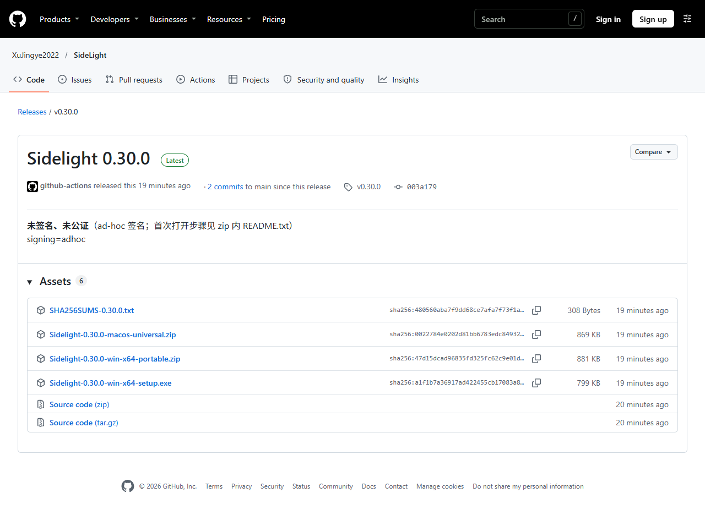
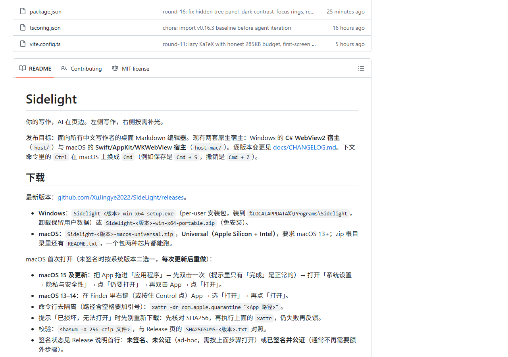
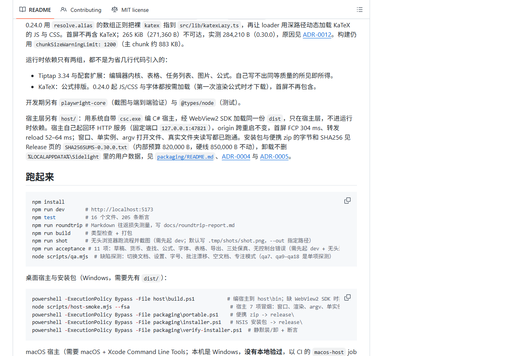

# 第 18 轮读者视角发现（v0.30.0）

- 检查对象：`README.md`、GitHub Release v0.30.0 页面与资产、`packaging/README.md`、`CONTRIBUTING.md`、`GLOSSARY.md`、`AGENTS.md` 的发布段。
- 方法：未登录 GitHub，1280×900 浏览器；Release API；下载并解包 macOS zip；读 Mach-O fat header；`Get-AuthenticodeSignature`；不读 `src/`。
- 引用约定：文中的 `文件:行` 都是仓库相对路径；截图在 `shots/round-18/`。
- 结论：发布页与 Windows 首次打开是两处硬卡点。贡献者入口、术语与可访问性次之。可访问性基线合格，主要问题是结构太平。
- 优先修：V1 + V2（用户路径），再 V3（贡献者），V4/V5 随后。V1–V5 都不改产品行为；V1 的发布模板会动 `release.yml` 和下一次发布流程。
- V1–V5 按影响从高到低排列。

## 0. 普通用户走查（README → Release）

“卡住”指文档没有给出下一步，或给出的路径不可用。

| 步骤 | 用户动作 | 结果 | 卡点 |
| :--- | :--- | :--- | :--- |
| 1 找安装包 | README 第 2 节 → Releases | 可以 | Release 页不说明三个包怎么选 |
| 2 Windows 首次打开 | 下载 setup.exe 后双击 | 卡住 | SmartScreen 与 WebView2 要求只在 `packaging/README.md`；README 下载段没有 |
| 3 macOS 首次打开 | 解压 zip 后双击 App | 部分 | README 有完整步骤；Release 页只写“见 zip 内 README.txt” |
| 4 校验 | 找 `SHA256SUMS-0.30.0.txt` | 部分 | 资产存在且哈希一致；README 只给 macOS 的 `shasum` 命令 |
| 5 找数据 | 滚到“数据与隐私” | 部分 | 内容有，但埋在 60 行功能列表后；没有“数据在哪”小节 |
| 6 卸载 | 在 README 找卸载 | 卡住 | README 没有卸载小节；步骤在 `packaging/README.md:20-24`，下载段没链 |
| 7 看本次更新 | 打开 Release 页 | 卡住 | 正文只有签名两行，没有 0.30.0 变更 |

## V1 Release v0.30.0 页面只有两行签名说明，不能作为下载落点

**影响**：所有从 GitHub Releases 进入的用户。Release 页是搜索与分享的主要落点。**难度**：M。

**证据**



页面：<https://github.com/XuJingye2022/SideLight/releases/tag/v0.30.0>

正文只有两行：

```text
**未签名、未公证**（ad-hoc 签名；首次打开步骤见 zip 内 README.txt）
signing=adhoc
```

资产有 4 个发布资产，另有 2 个源码包（截图显示 Assets 6）：

| 项 | 现状 | 判断 |
| :--- | :--- | :--- |
| 资产命名 | `Sidelight-0.30.0-win-x64-setup.exe`、`-win-x64-portable.zip`、`-macos-universal.zip`、`SHA256SUMS-0.30.0.txt`；与 `README.md:11-12` 的占位名一致 | 清楚 |
| 大小 | GitHub 显示 799 KB / 881 KB / 869 KB；精确值 817,983 / 902,274 / 890,004 B | 可见，但正文不解释 |
| 签名 | 首行写了“未签名、未公证（ad-hoc）”；第二行是 `signing=adhoc`；Windows setup 的 Authenticode 状态为 `NotSigned` | 部分清楚，Windows 未提 |
| Gatekeeper | 只写“见 zip 内 README.txt”；完整步骤在 `README.md:14-22` 与 zip 内 `README.txt` | 落点页不可执行 |
| Intel | 正文未提；`README.md:12` 与 zip 内 `README.txt` 写 Universal（arm64 + x86_64）；实测 fat header 有 2 个 arch | 不清 |
| 已知限制 | 正文未提；`README.md:60-72` 有 | 缺 |
| 本次更新 | 正文未提；`docs/CHANGELOG.md:5-16` 有 0.30.0 条目 | 缺 |
| 校验 | `SHA256SUMS-0.30.0.txt` 有 3 行，本机复算与 setup、portable、macOS 三包一致 | 资产合格，正文不教怎么用 |

根因在发布流水线：`.github/workflows/release.yml:155-167` 只把签名状态写进 `signing.txt`，`:248-260` 又把这个文件当作整个 Release 正文（`body_path: out/signing.txt`）。`signing=adhoc` 是给脚本看的键值，直接暴露给用户。

**具体改法**

1. 新建 `docs/release-notes/0.30.0.md`（或 `.github/release-notes/0.30.0.md`），固定六节：
   - 本次更新：从 `CHANGELOG.md:5-16` 取 3 条，例如“大纲页签隐藏文件树、深色对比度 48/48、错误提示可读屏”。
   - 下载哪个包：三行表格，写明“Windows 安装版 / Windows 免安装 / macOS 通用”。
   - Windows 首次打开：SmartScreen 两步、WebView2 要求、安装路径。
   - macOS 首次打开：macOS 15+ 与 13–14 两条路径，加 `xattr` 兜底。
   - 数据与卸载：两行，指向 `%LOCALAPPDATA%\Sidelight` 与文档旁 `.sidelight/`。
   - 已知限制：未签名、无自动更新、`.md` 默认不关联。
2. 改 `release.yml`：正文读发布说明文件，签名状态放最后一行；`signing=adhoc` 改为 HTML 注释或删除。
3. 回填当前版本：`gh release edit v0.30.0 --notes-file docs/release-notes/0.30.0.md`，或用 GitHub 页面编辑 Release 正文。不需要改 tag，也不需要重打资产。
4. 大小加一句解释：“安装包约 800 KB，因为复用系统 WebView2，不打包浏览器内核。”

**验收**：未登录打开 Release 页，首屏能回答“我该下哪个、双击后弹出什么、第一次怎么打开、数据在哪、怎么卸”。

## V2 README 下载段对 Windows 只给包名，首开、依赖、卸载都推给第二份文档

**影响**：Windows 是首发平台。用户下载后会在 SmartScreen 或 WebView2 检查处停住。**难度**：S。

**证据**



- `README.md:11` 的 Windows 只有一条：包名、安装路径、“卸载保留用户数据”。没有首次打开、没有 SmartScreen、没有 WebView2、没有卸载步骤。
- `README.md:14-22` 的 macOS 有 6 条：两套 Gatekeeper 流程、`xattr`、损坏排查、校验、签名状态、0.28.1 升级。
- SmartScreen 在 `packaging/README.md:13`；WebView2 要求在 `:18`；卸载步骤在 `:20-24`。`README.md:11` 没有链接到这份文件。
- `README.md:64` 写“安装用 `release/Sidelight-0.30.0-win-x64-setup.exe`”。`release/` 被 `.gitignore:10` 忽略，GitHub 上 `tree/main/release` 返回 404。这条路径在仓库里不存在。
- `README.md:63`、`:71-72` 把 HKCU、SmartScreen、真实 IME、Alt+F4、只读目录等内部验收项写进“现在不能做什么”。用户会读成“这个软件还没做完”。
- 数据位置在 `README.md:80-86`，但在功能清单与限制之后，没有“数据在哪”标题。
- `README.md:78` 在“数据与隐私”开头写“待产品负责人确认后再作为对外承诺”。这是内部审批状态，公开 README 里会削弱信任。
- `packaging/README.md:15-16` 有两个编号“4”，安装步骤编号重复。

**具体改法**

在“下载”段后直接补三节，不要求用户滚到“现在不能做什么”：

```markdown
### Windows 首次打开

1. 双击 `Sidelight-<版本>-win-x64-setup.exe`。
2. 出现「Windows 已保护你的电脑」时，点「更多信息」→「仍要运行」。安装包没有代码签名。
3. 需要 Microsoft WebView2 运行时（Windows 11 自带）。安装器会检查；缺少时先装 WebView2。
4. 默认装到 `%LOCALAPPDATA%\Programs\Sidelight`，从开始菜单启动。

### 卸载

设置 → 应用 → 已安装的应用 → Sidelight → 卸载。卸载保留 `%LOCALAPPDATA%\Sidelight` 与文档旁的 `.sidelight/`；要彻底清掉，手动删这两个位置。

### 数据在哪

- 最近文件：`%LOCALAPPDATA%\Sidelight\recent.json`
- 草稿与批注：文档旁 `.sidelight/drafts/`、`.sidelight/annotations/`
- 删除的文件：工作区 `.sidelight/trash/`
```

其余改动：

1. 把 `README.md:64` 的 `release/...` 改成 Release 页链接，并补 `packaging/README.md` 链接。
2. 把“未验”清单移到 `docs/iteration/STATE.md` 或 `docs/qa-report.md`；README 只留用户能感知的限制：未签名、无自动更新、`.md` 默认不关联。
3. 修 `packaging/README.md:15-16` 的重复编号。
4. 给 Windows 加校验命令：`certutil -hashfile <文件> SHA256` 或 `Get-FileHash <文件> -Algorithm SHA256`。
5. 把 0.28.1 升级历史移到 CHANGELOG；下载段只服务当前版本。
6. 把 `README.md:78` 的审批说明移到本轮计划的 `PRIVACY.md`；README 只留三行“数据只在本机、密钥只存本地、不代管请求”，并链接 PRIVACY。正式隐私承诺仍标“待产品负责人确认”。

**验收**：Windows 用户在 README 首屏完成“下载 → 过 SmartScreen → 装 WebView2 → 启动 → 找数据 → 卸载”，不需要打开第二份文档。

## V3 贡献者从 README 找不到贡献入口，也找不到发布流程

**影响**：外部贡献者与接手维护的人。构建命令齐全，但规则和发布路径缺失。**难度**：S–M。

**证据**



| 目标 | README 现状 | 缺口 |
| :--- | :--- | :--- |
| build / test | `README.md:107-116` 有 `npm install`、`dev`、`test`、`build`、`roundtrip`、`shot`、`acceptance` | 没有 Node 版本；没有 `npm ci`；`npm install` 与 `CONTRIBUTING.md:10` 的 `npm ci` 不一致 |
| 构建纪律 | `README.md:112` 直接列 `npm run build` | `CONTRIBUTING.md:20` 明确说“实施期间不要跑它，它会清空 dist/”。两份文档冲突 |
| 测试数 | `README.md:110` 写死“16 个文件、205 条断言” | `CONTRIBUTING.md:22` 要求“不要在文档里写死数字” |
| 打包 | `README.md:118-126` 有 Windows host、便携 zip、NSIS、verify；`:128-136` 有 macOS | 命令齐全；`packaging/README.md` 只在 `:64` 与 `:103` 出现 |
| ADR | `README.md:159-175` 有 15 条单独链接 | `docs/adr/` 只出现在 `:152` 的代码块里，不可点；没有 `docs/adr/README.md` 索引 |
| 发布 | 没有发布小节 | 步骤只在 `AGENTS.md:56-67`；`README.md:136` 只提 macOS CI 的 `ci.yml`；`release.yml` 没提 |
| 贡献规则/许可 | README 全文没有 `CONTRIBUTING.md`、`AGENTS.md`、`LICENSE`、`GLOSSARY.md` 的链接 | GitHub 侧栏会自动显示 Contributing 与 MIT（见 `shots/round-18/repo-home.png`），但 README 文本没有入口 |

**具体改法**

1. 在“跑起来”前加“参与贡献”小节，链接 `CONTRIBUTING.md`、`AGENTS.md`、`GLOSSARY.md`、`LICENSE`、`docs/adr/`，以及本轮计划新增的 `SECURITY.md`、`PRIVACY.md`。
2. “跑起来”开头补两行：`Node 24（见 .nvmrc）`、`npm ci`。
3. `npm run build` 后加注：“维护者收尾时串行跑；并行开发用 `npx vite build --outDir .tmp/build`。”与 `CONTRIBUTING.md:20` 对齐。
4. 删掉写死的测试数，改成“以 `npm test` 输出为准”；数字只留在 `STATE.md`。
5. 加“发布”小节，5 行以内：改版本号与 CHANGELOG → 本地打包 → `verify-installer.ps1` → 推 `v*` tag，或手动 `tag` + `publish` → 根代理复核。链接 `AGENTS.md:56-67` 与 `.github/workflows/release.yml`。
6. 建 `docs/adr/README.md` 索引（编号、标题、一行结论），并在 README 里链接这个索引。
7. 建 `.github/ISSUE_TEMPLATE/` 与 `PULL_REQUEST_TEMPLATE.md`；本轮仓库治理已有目标，这里只登记缺口。

**验收**：新贡献者只读 README，能在 10 分钟内找到 Node 版本、安装命令、测试命令、不能跑 build 的原因、ADR 索引、发布入口。

## V4 「缓存」把草稿与批注说成临时缓存，品牌和「正文/原文」也不统一

**影响**：用户理解与数据安全。把 `.sidelight/` 当缓存删掉，会丢草稿与批注。**难度**：S。

### 4.1 “缓存”指了三种东西

- `README.md:52`：“缓存（草稿/批注）从旧键迁到新键”。
- `README.md:57`：“草稿与批注存在……`.sidelight/`”。
- `AGENTS.md:51`：“缓存只写 `.sidelight/`”。
- `packaging/README.md:24`：“WebView2 配置、缓存、`recent.json`”。
- `CHANGELOG.md:329`：“新增 `.sidelight` 缓存目录”。
- `GLOSSARY.md` 没有“缓存”条目。

同一个词同时指：WebView2 可再生成的缓存、`.sidelight` 里的草稿与批注、`lib/` 里的缓存模块。缓存可以删，草稿与批注不能删。两者混在一起，用户会删错。

**改法**：在 `GLOSSARY.md` 加“缓存（Cache）：可再生成的临时数据，例如 WebView2 缓存；不得指代草稿与批注。”把当前文档里的“缓存（草稿/批注）”改成“草稿与批注”或“本地数据”。`AGENTS.md:51` 改成“草稿与批注只写 `.sidelight/`”。`packaging/README.md:24` 保留“缓存”，明确它指 WebView2。

### 4.2 「正文」「原文」与「页边批注」

- `README.md:37`：“模型带着原文、批注与上下文回答”。这里指正文/选中文字，但 `GLOSSARY.md:11-13` 规定用“正文”，并明确避免“原文”。
- `README.md:183`：“按原文保留”。这里指磁盘上的原始 Markdown 字节，是另一个概念。
- `README.md:161`：“意见形式：页边批注”；`GLOSSARY.md:23` 的词条是“批注”。`README.md:31` 的“点页边任一批注”已经把位置和名词分开。两处应统一。

**改法**：`README.md:37` 改成“选中文字、批注与上下文”；`README.md:183` 首次出现时写“原始 Markdown（原文）”，并在 `GLOSSARY.md` 加“原始 Markdown（Source text）”条目。全篇只保留一个“原文”含义。`README.md:161` 改成“意见形式：批注，锚定正文范围”；“页边”只用来描述位置，不并入名词。若要保留“页边批注”，在 `GLOSSARY.md` 明确它是“批注”的界面别名，只用于界面文案。

### 4.3 品牌拼写

- `README.md:1`：`# Sidelight`。
- `README.md:9` 的链接：`github.com/XuJingye2022/SideLight/releases`。
- GitHub 仓库标题：`SideLight`。Release 标题与资产：`Sidelight`。
- `GLOSSARY.md:40`：“和侧灯来回形成的对话”。

正文用 `Sidelight` 是统一的；差异在仓库名、URL 和“侧灯”。用户会在面包屑、Release 页、README 标题之间看到两种拼写。

**改法**：确定 `Sidelight` 为唯一产品名；`GLOSSARY.md:40` 的“侧灯”改成 `Sidelight`。仓库名可在 1.0 前改成 `Sidelight`（GitHub 会重定向旧 URL），或在 README 首段加一句“仓库地址沿用 `SideLight` 拼写”。不要继续新增 `SideLight` 写法。

### 4.4 用户路径上的英文残留

| 现在 | 位置 | 建议 |
| :--- | :--- | :--- |
| `per-user 安装包` | `README.md:11`、`:64` | “仅为当前用户安装（不需要管理员）” |
| `Universal` | `README.md:12` | “Apple Silicon 与 Intel 通用（Universal）” |
| `ad-hoc` | `README.md:21` | “临时签名（ad-hoc，未公证）” |
| `signing=adhoc` | Release 正文 | 删除，或放进 HTML 注释 |
| `trash` | `README.md:51`、`:62`、`:84`、`:86` | “回收站（`.sidelight/trash/`）” |
| `SmartScreen`、`HKCU` | `README.md:64` | 首次出现加中文解释；`HKCU` 可改成“当前用户注册表项” |

开发段里的 `frontmatter`、`callout`、`gzip`、`FCP`、`argv`、`BOM` 可以保留，因为读者是贡献者。下载与卸载段是普通用户路径，应尽量用中文。

### 4.5 机器翻译感

未发现成句的机器翻译痕迹。主要问题是工程内部语气，例如“发布目标”“内部预算 820,000 B（硬线 850,000 B 不动）”“首屏 FCP 304 ms”。这些内容应留在开发段或 STATE，不应出现在下载与首次打开路径。

## V5 README 可访问性基线合格，但结构太平、链接文字多为路径

**影响**：读屏用户与快速扫读的用户。**难度**：S。

**已合格**

- 渲染后是 1 个 H1 + 10 个 H2，没有跳级。
- 4 个围栏代码块都带语言：`bash`、`powershell`、`bash`、`text`。
- 没有 ``，所以没有缺 alt 的图片；反过来说，也没有一张产品截图。
- 中文标题锚点由 GitHub 生成，可用。

**待修**

1. “下载”下的 `**Windows**`、`**macOS**` 是加粗，不是标题。读屏用户无法按 H3 跳到平台段落。改成 `### Windows`、`### macOS`、`### 首次打开（macOS）`、`### 校验`。
2. `**KaTeX 为什么现在按需加载**` 是加粗伪标题。改成 `### KaTeX 为什么现在按需加载`，或移到 ADR-0012。
3. 链接文字多为路径：`docs/CHANGELOG.md`、`packaging/README.md`、`docs/roundtrip-report.md`，且重复出现。改成“变更日志”“安装包说明”“Markdown 往返报告”，路径留在 URL 里。
4. `README.md:89-90` 的列表后直接接 `## 依赖与体积`，中间缺空行（markdownlint MD022）。GitHub 仍能渲染，但源码检查会报。
5. `README.md:64` 是一条几百字的列表项，含安装、卸载、关联、未验四项。拆成 3 条短列表。
6. 全文约 9,700 字，没有目录。加 5 行目录，或依赖 GitHub 的 Outline 按钮。
7. 加一张产品截图，并写 alt，例如：“Sidelight 双栏界面：左侧 Markdown 正文，右侧页边批注。” 这同时补上视觉说明与无障碍文本。
8. Release 正文也没有标题，只有一行加粗。V1 的发布说明模板应使用 `###` 分节。

**验收**：用读屏的标题导航能从“下载”跳到“Windows”“macOS”“卸载”“数据在哪”；用链接列表能听懂每个链接去哪；所有代码块有语言。

## 优化机会（最多 3 条）

1. **30 秒上手**：README 标题下加 3 行“下载 → 首次打开 → 写并保存”，每行一个链接。普通用户不必先读 60 行功能清单。
2. **下载选择表**：三行表格，“Windows 安装版 / Windows 免安装 / macOS 通用”，每行写“适合谁、约多大、首次打开要注意什么”。这能直接减少选错包与 SmartScreen 流失。
3. **一张界面截图 + alt**：放在“现在能做什么”开头。现在 README 没有一张图，读者无法在下载前判断界面是否适合自己。

## 未验证与边界

- 未在真实 Windows 桌面走安装与 SmartScreen。`Get-AuthenticodeSignature` 只证明 setup.exe 为 `NotSigned`；SmartScreen 的实际弹窗文案来自 `packaging/README.md:13` 与 `README.txt`，未截图。
- 未在 macOS 上运行或验签。已解包 zip、确认根目录有 `Sidelight.app` 与 `README.txt`、解析 Mach-O fat header 得到 x86_64 + arm64；Gatekeeper 流程与 `codesign` 状态未实测。
- Release 页截图是未登录、1280×900、2026-11-16 的状态；没有测手机宽度。
- 三个资产的 SHA256 已复算，与 `SHA256SUMS-0.30.0.txt` 一致。
- 没有运行 `npm test` / `npm run build`，避免与并行工作争 `dist/`；测试数未独立复核。
- 没有读 `src/`。所有结论来自 README、Release 页、发布脚本、打包说明与页面 DOM。

## 证据文件

- `shots/round-18/release-v0.30.0.png`：Release v0.30.0 页面，正文两行、Assets 6、大小。
- `shots/round-18/readme-download.png`：README 下载段，Windows 一条、macOS 六条。
- `shots/round-18/readme-build.png`：README“跑起来”段，无 Node 版本、无贡献入口。
- `shots/round-18/readme-limitations.png`：README“现在不能做什么”，含 `release/...` 路径与内部验收项。
- `shots/round-18/repo-home.png`：仓库首页，侧栏有 Contributing 与 MIT，README 文本没有。
- `https://api.github.com/repos/XuJingye2022/SideLight/releases/tags/v0.30.0`：Release 正文与资产元数据。
